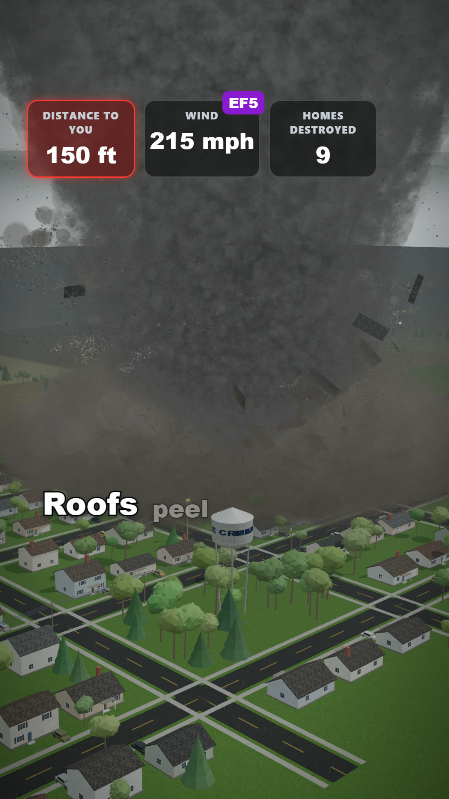
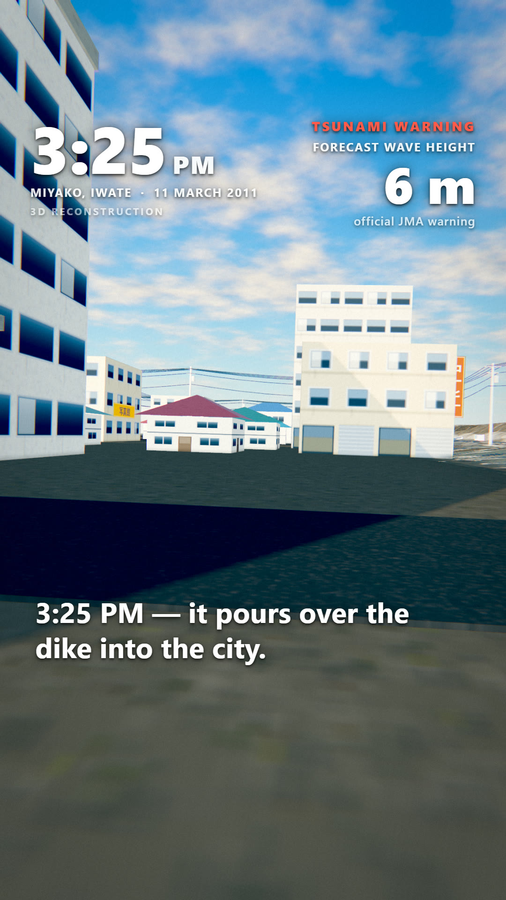
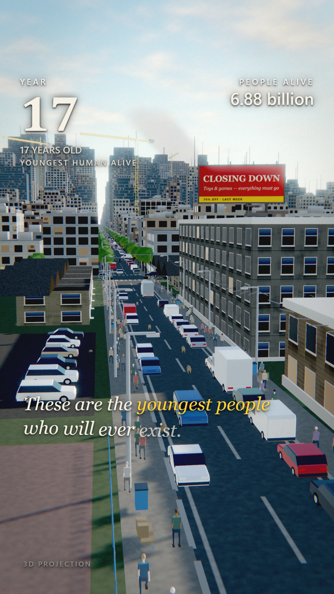
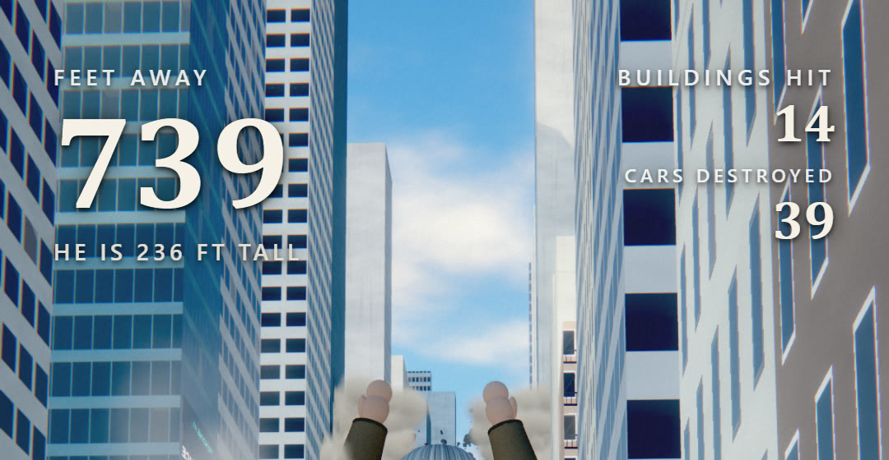
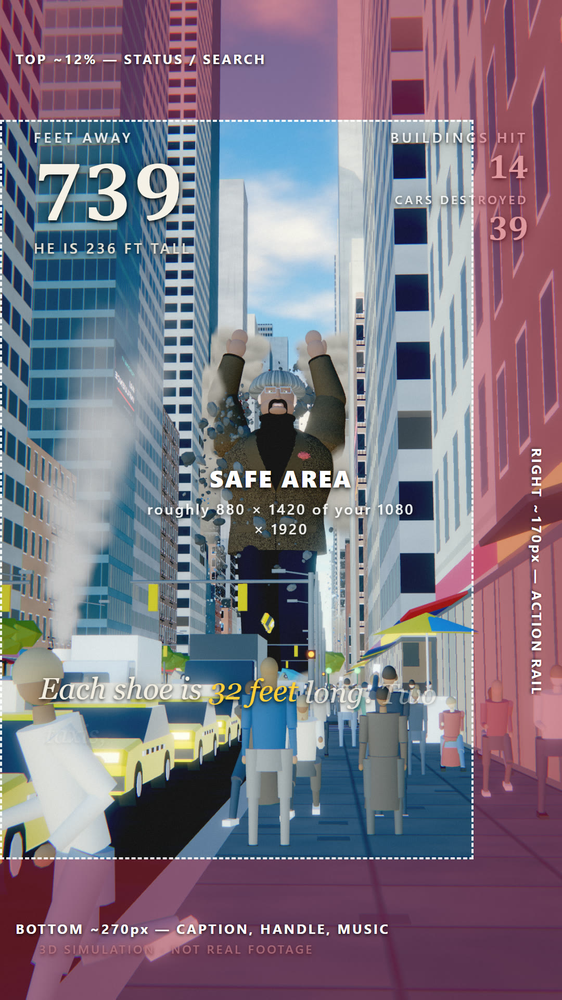

# What-If Video Kit

The Claude Code skills behind the "What if a tornado hit your town?" style of vertical
short-form video — a cinematic 3D simulation that runs in a browser with three.js and exports
frame-exact to a 1080×1920 MP4.

This repo is the downloadable toolkit for the course. Install the skills, open Claude Code in
an empty folder, and describe the disaster you want.

---

## What's in here

| Folder | What it is |
|---|---|
| `skills/disaster-animation/` | The main engine skill — force fields, destruction, procedural cities and crowds, sky and lighting, the 9:16 HUD, the preview harness, and the offline MP4 exporter. 23 reference documents, 4 scripts, 1 runnable template. |
| `skills/sung-vocals/` | Optional. Renders a real *sung* vocal (lyrics on a melody) fully offline with Piper + WORLD, plus a matching lip-sync track. Only needed if a character in your video sings. |

A "skill" is a folder of instructions that Claude Code reads automatically when your request
matches it. You do not call it manually. You install it once and then just describe the video.

---

## Install

### 1. Prerequisites

| Tool | Why | Get it |
|---|---|---|
| **Claude Code** | The thing that writes the simulation | `npm i -g @anthropic-ai/claude-code` |
| **Node.js 20+** | Runs the preview and export harnesses | nodejs.org |
| **Google Chrome** | Headless renderer for screenshots and export | google.com/chrome |
| **ffmpeg** | Encodes the frames into an MP4 | ffmpeg.org — put `ffmpeg.exe` on your PATH, or in an `ffmpeg/bin/` folder beside your project |

Python 3.10+ is only needed for `sung-vocals`.

### 2. Install the skills

Copy both folders into your Claude Code skills directory.

**Windows (PowerShell)**
```powershell
git clone https://github.com/SnoochiMink/what-if-video-kit.git
Copy-Item -Recurse what-if-video-kit\skills\* "$env:USERPROFILE\.claude\skills\"
```

**macOS / Linux**
```bash
git clone https://github.com/SnoochiMink/what-if-video-kit.git
mkdir -p ~/.claude/skills
cp -r what-if-video-kit/skills/* ~/.claude/skills/
```

You should end up with `~/.claude/skills/disaster-animation/SKILL.md`.

### 3. Check it took

Start `claude` in any folder and ask:

> What skills do you have available?

`disaster-animation` should be in the list. If it isn't, check the path — the `SKILL.md` must
be exactly one level deep inside `skills/`.

---

## First video

```bash
mkdir my-tornado && cd my-tornado
claude
```

Then paste:

> Build a ~60 second 9:16 disaster animation: **What if an EF5 tornado hit your town?**
> Use the disaster-animation skill. Stand up the preview harness first and show me a frame
> before you build anything else.

Claude scaffolds the project, renders a frame, and iterates. Expect roughly 2–5 hours of
back-and-forth for a first video, and about 20 minutes of GPU time for the final export.

---

## The harness commands you'll use

Run these from inside your project folder.

```bash
node tools/shoot.mjs 12 28 41            # three preview PNGs at those film times
node tools/sheet.mjs 13 16 19 24         # one contact sheet of several moments
node tools/export.mjs --from=35 --to=45  # export a 10-second range to check a change
node tools/export.mjs                    # the full 1080x1920 60fps MP4
```

---

## Licence

MIT — see `LICENSE`. Use these for commercial videos freely. The skills are instructions, not
a rendering library; everything they produce is your own code.

---

## What it produces

| | | |
|---|---|---|
|  |  |  |

**The title card** &mdash; three lines, over the climax, never over a calm establishing shot:


**The top-left counter** &mdash; a real value read out of the simulation, in lining tabular figures:



**The 9:16 safe area** &mdash; red is what TikTok draws its own interface over:


